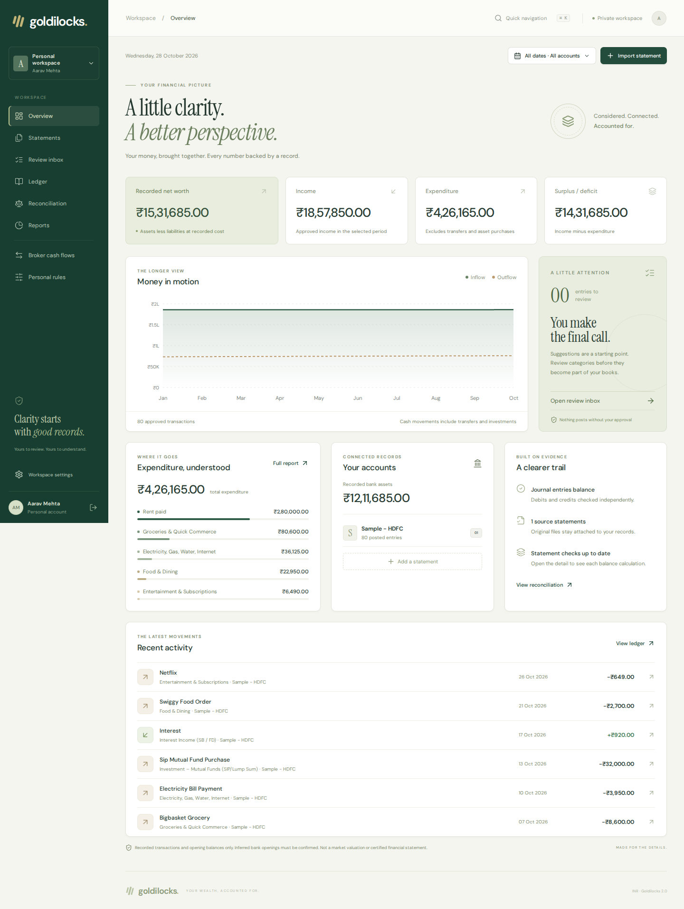

# Goldilocks — Your wealth, accounted for.

A bank statement tells you what moved. Goldilocks helps you understand **why it moved**, check the accounting, and follow every posted entry back to its source.

**Live version 2:** [Open Goldilocks](https://goldilocks-workspace.onrender.com) · [Release checks](docs/VALIDATION.md)

> Hosting note: the live version runs the real Python API and React workspace on Render Free. **Its storage is temporary:** accounts and records can disappear when the host restarts or sleeps. Use fictional files on this public deployment. For lasting records, use the documented Docker volume or paid persistent-disk setup. The old server was left untouched to protect any existing records.



*The screenshot comes from the running app. The person and transactions are fictional; the chart and totals are calculated by the real API.*

## The problem

A statement may mix salary, groceries, transfers, loan repayments and investments. Putting every credit into “income” and every debit into “expense” gives the wrong picture. It is also hard to know which source produced a report total or what somebody changed later.

## The solution

Goldilocks follows a simple sequence:

1. **Import** a PDF, XLS, XLSX or CSV bank statement.
2. **Review** suggested categories in your personal inbox. Nothing is posted automatically.
3. **Correct or split** a transaction when it needs more context. For example, separate loan principal from interest.
4. **Approve** selected entries. The original statement, review action and balanced journal are kept together.
5. **Understand** income, expenditure, recorded assets, liabilities, broker cash transfers and reconciliation gaps.

## What works in version 2

| Area | What you can actually do |
| --- | --- |
| Accounts | Create an account, sign in, sign out and recover with a saved one-time recovery code. Financial records are scoped to the signed-in user. |
| Statements | Import tabular PDF/XLS/XLSX/CSV files, multi-page PDFs and supported text layouts. Unlock protected files using their correct password. |
| Scans | Use Tesseract OCR when it is installed. OCR output still needs human checking. The Docker image includes Tesseract. |
| Bank recognition | Recognise HDFC, ICICI, SBI, Axis, PNB, Union, AU and IDFC First labels. Layout support is **not universal**; see below. |
| Classification | Apply personal rules, private reviewed examples, financial rules and a TF-IDF + calibrated LinearSVC fallback trained on authored synthetic examples. |
| Review | Search, sort, select and approve entries. Reclassify pending or posted entries with an activity trail. |
| Allocations | Split a payment into principal and interest, or redemption proceeds into principal and gain. Parts must exactly equal the original amount. |
| Ledger | Post an entire selection atomically. Money in the journal uses integer paise, not floating-point arithmetic. |
| Reconciliation | Check opening + credits − debits against closing; also check each running balance. Inferred opening balances are explicitly labelled. |
| Three-book view | View income/expenditure, a recorded-cost balance sheet, and independent journal/equation checks. |
| Opening positions | Enter pre-existing bank balances, other assets and outstanding debt. |
| Reporting | Filter by dates and account; download CSV, XLSX and PDF reports. |
| Provenance | Open an entry's original narration, file, row/page metadata, journal lines and review history. |
| Broker cash flows | Separate deposits and withdrawals from investment performance. A cash transfer is not a capital gain. |
| Interface | Responsive React/TypeScript workspace, real charts, accessible dialogs, keyboard navigation, loading/error states and mobile navigation. |

## Try it in five minutes

1. Create your own account with a password of at least 12 characters.
2. **Save the recovery code.** No recovery email is sent. The application does not require an email service.
3. On the empty overview, choose **Explore with fictional sample data**.
4. Open an entry and check its category. Select a page of entries and click **Post selected**.
5. Visit **Overview**, **Ledger**, **Reconciliation** and **Reports** to see the result.
6. To use your own supported statement, choose **Import statement**. Reuse the same account label for future statements from that account.

The sample button inserts 80 fictional rows into **your** review queue. It does not create fake dashboard totals or automatically approve anything.

## Run on your computer

You need **Python 3.11+**. Node.js 22 is needed only when changing/rebuilding the frontend. OCR additionally needs Tesseract.

```bash
git clone https://github.com/Sankalp-gupta1/Goldilocks--HNI-ledger-board-SDE-.git
cd Goldilocks--HNI-ledger-board-SDE-
python -m venv .venv
# macOS / Linux:
source .venv/bin/activate
# Windows PowerShell instead:
# .venv\Scripts\Activate.ps1
pip install -r requirements.txt
python hni_accounting_system.py
```

Open **http://127.0.0.1:8082**. Built frontend files are included in `web/`, so a Python-only installation works immediately.

To rebuild after editing React:

```bash
npm ci --prefix frontend
npm run build --prefix frontend
```

For frontend development, run `npm run dev --prefix frontend` in a second terminal. Vite forwards `/api` to the Python server on port 8082.

## Run with Docker and durable local storage

```bash
docker build -t goldilocks .
docker volume create goldilocks-data
docker run --rm -p 8082:8082 -e APP_ENV=local \
  -v goldilocks-data:/var/data goldilocks
```

Open http://localhost:8082. The named volume survives container replacement. `APP_ENV=local` allows HTTP cookies on your computer; use HTTPS and `APP_ENV=production` on a public host. Do not delete the volume unless you intend to erase its records.

Cloud setup, backups, existing-data migration and the paid-disk Blueprint are explained in [DEPLOYMENT.md](docs/DEPLOYMENT.md). **Do not run a real financial ledger on a temporary cloud filesystem.**

## Test it

```bash
pip install -r requirements-dev.txt
python -m pytest tests -q
npm ci --prefix frontend
npm run build --prefix frontend
cd frontend
npx playwright install chromium
# macOS / Linux, with the project virtual environment available:
npx playwright test
# If you used a different Python path:
# PYTHON_BIN=python npx playwright test
```

The browser test starts a real Python API and uses a separate test database. It creates fictional accounts, imports documents, posts transactions, checks evidence/exports and visits the mobile interface. Backend tests cover isolation, recovery, duplicate imports, concurrent uploads, financial identities, splits, encrypted files and OCR. GitHub Actions runs both suites.

## How it is built

- **Frontend:** React 19, TypeScript, Vite, TanStack Query and Table, Recharts, Radix Dialog and Lucide icons. Fonts are hosted with the app.
- **API:** Flask, with Gunicorn for production. The previous process-global HTTP login handler has been removed.
- **Database:** SQLite with WAL, bounded busy waits, user-scoped queries and atomic approval transactions.
- **Documents:** pdfplumber, PyMuPDF, pypdf, openpyxl, xlrd, msoffcrypto-tool and Tesseract/pytesseract.
- **Classification:** the existing financial rules plus scikit-learn TF-IDF and calibrated LinearSVC. No ChatGPT, Gemini, banking or market-price API is called.
- **Accounting:** integer-paise journal lines, source-linked approvals, explicit opening positions and separate reconciliation checks.

“Processing on this server” does not mean “the file never leaves your laptop” when you use a hosted deployment. See [SECURITY.md](docs/SECURITY.md).

## A simple map of the code

| File or folder | What it does |
| --- | --- |
| `goldilocks/app.py` | Receives browser requests and checks authentication before accessing account data. |
| `goldilocks/auth.py` | Password hashing, revocable sessions, login limits and recovery codes. |
| `goldilocks/ingestion.py` | Reads statements and preserves source-row details; reports ambiguous rows. |
| `goldilocks/service.py` | Imports, deduplication, personal rules, review, splits and atomic approval. |
| `goldilocks/accounting.py` | Builds journal lines and calculates accounting reports. |
| `hni_accounting_system.py` | Retained financial category/rule engine, legacy parser helpers and the compatible start command. |
| `hni_ledger_extension.py` | Existing schema/profile helpers. Old routes are not attached to the new API. |
| `generate_dataset.py` | Authored synthetic transaction generator used by model training. |
| `frontend/src/` | React screens, shared API functions and the custom visual design. |
| `web/` | Built browser assets, committed for the existing Python-only Render build. Rebuild rather than editing these files. |
| `samples/` | Fictional data and a statement template. |
| `tests/`, `frontend/tests/` | Real backend and browser regression tests. |
| `scripts/backup.py` | Creates a consistent SQLite backup without overwriting an existing backup. |
| `Dockerfile`, `render.yaml` | Reproducible cloud runtime, including OCR; the Blueprint requires paid durable storage. |

## Important boundaries

- A bank's name does not identify every layout it has ever issued. The tests include eight bank-labelled canonical layouts, not a certification of all genuine bank exports. Unsupported/ambiguous layouts must be adapted or converted to the CSV template.
- Limits: 15 MB/file, 80 PDF pages, 20 scanned pages, 20,000 transactions/import and 150 MB of original files/account. Scans can be misread.
- The opening balance may be inferred from the first row. The interface distinguishes that from a confirmed statement summary.
- Identical entries within a single file retain their occurrence numbers. Cross-file identical transactions can still be ambiguous; overlap detection is conservative and must be reviewed.
- Reports use recorded transactions and opening positions. They do not know about an unimported account, an unstated liability, a property's market price or a missing trade lot.
- Balanced journals prove arithmetic balance, not completeness or correct classification. This is not a certified audit or a tax-filing product.
- Synthetic model scores are suggestions, not measured real-world accuracy. Personal corrections are stored privately; the shared model is not retrained on customer statements.
- Historical rows may lack source files or opening positions. Existing stored data is not magically reconstructed.
- The current architecture targets a single server with a durable disk. Multi-instance scaling, automated off-host backups, MFA and email verification need further work.

## Further reading

- [What the original README claimed, and what changed](docs/README_AUDIT.md)
- [Architecture and design decisions](docs/ARCHITECTURE.md)
- [Accounting explained with small examples](docs/ACCOUNTING.md)
- [Security and data handling](docs/SECURITY.md)
- [Deployment and backup guide](docs/DEPLOYMENT.md)
- [Verification results and release status](docs/VALIDATION.md)

Future work: independently labelled bank fixtures, measured classifier evaluation, broker contract notes and trade lots, live portfolio valuations, multi-entity consolidation, tax-specific rules and a durable background import queue. These are roadmap items, not current promises.

Built for Sankalp Gupta's Goldilocks HNI Ledger project. AI coding assistance was used during the version 2 audit and implementation; all displayed financial sample records are fictional.
