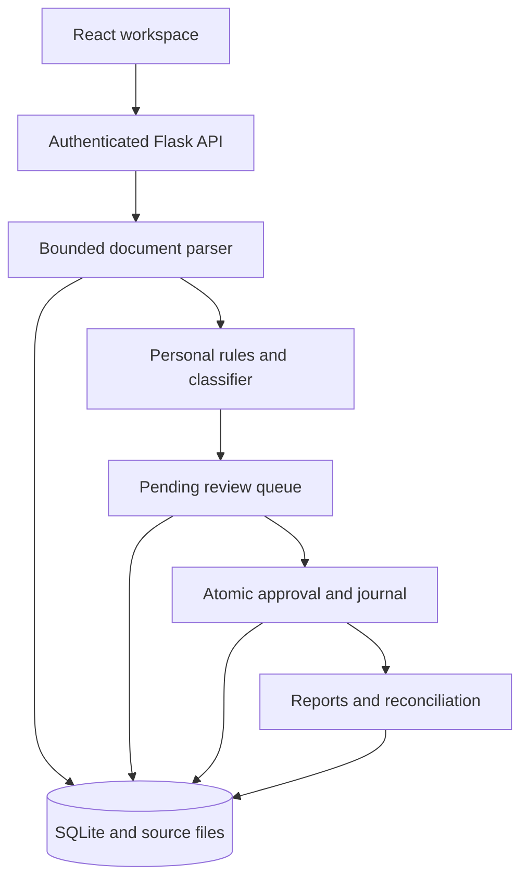

# How the pieces fit together

The browser is the workspace. The API owns access control and business rules. SQLite stores the user's sources, review decisions and accounting entries together.

## A statement's journey

1. The API checks the session, request origin, upload size and account label.
2. The parser reads supported tables or explicit debit/credit text. A protected file needs its real password. An image-only PDF can use local OCR.
3. A SHA-256 file hash prevents importing the exact same statement twice into the same user's account. Per-row fingerprints include occurrence counts, preserving two identical payments within one source.
4. Classification uses that user's reviewed examples first, then personal rules, existing financial rules and the synthetic model. Low-confidence suggestions and ambiguous EMIs remain unresolved.
5. A database transaction saves the original bytes, parsed rows, candidate categories and import event. The password is discarded.
6. The user reviews rows. A correction adds history and a private remembered example. Splits preserve the original transaction amount and allocate it to multiple categories.
7. Approval validates the entire selected set before writing. Ledger entries, journal lines, pending status and audit events commit together.
8. Reports read approved journal entries. Reconciliation separately compares parsed source balances. These checks answer different questions.

## Important choices

**One server, one database.** SQLite makes source retention and posting atomic without a separate object store. WAL helps concurrent reads, and short write transactions use a busy timeout. This is a deliberate small-deployment design, not a multi-region system. A hosted instance must have a persistent disk.

**Integer paise for journals.** A transaction worth INR 125.25 becomes 12,525 paise. Debit/credit equality is checked using integers. Legacy source amounts remain in the existing schema; conversion happens at the accounting boundary.

**No process-global current user.** Each request resolves an opaque cookie to a server-side hashed session. Financial queries use its user ID. React clears non-session query data on account changes and cancels in-flight reads.

**Explicit uncertainty.** An ML score is not proof. An inferred opening is not an independent statement balance. A broker cash transfer is not portfolio profit. The interface keeps those distinctions visible.

**Preserve the useful engine.** The existing rule/category engine and profile helpers are reused. The unsafe legacy HTTP handler and inline frontend are removed. New service methods own import/review/posting instead of calling the old global-user workflows.

**No shared customer training data.** Synthetic examples bootstrap the model. Personal reviewed examples are exact matches within the same user/direction, not global retraining.

**Compiled assets in the repository.** The original Render service builds Python only. Committing `web/` lets that existing command serve the React app. CI rebuilds from `frontend/`; generated assets should never be edited by hand.

## Main API groups

All mutations require `X-Goldilocks: 1` and an allowed same-origin request. Except health, session and authentication, APIs require a valid session cookie.

| Group | Endpoints |
| --- | --- |
| Authentication | `GET /api/session`, `POST /api/register`, `/api/login`, `/api/logout`, `/api/recover` |
| Import | `POST /api/import`, `/api/sample`; `GET /api/statement-template`, `/api/statements`, `/api/statements/{id}/source` |
| Review | `GET /api/pending`; `POST /api/transactions/{id}/classification`, `/api/transactions/{id}/split`, `/api/approve` |
| Reporting | `GET /api/overview`, `/api/ledger`, `/api/reports`, `/api/reconciliation`, `/api/trading`, `/api/export/{csv,xlsx,pdf}` |
| Evidence | `GET /api/trace/{id}` |
| Rules | `GET/POST /api/rules`, `DELETE /api/rules/{id}`, `GET /api/learning-examples` |
| Context | `GET/PUT /api/profile`, `GET/PUT /api/openings`, `PUT /api/statements/{id}/balances` |
| Operations | `GET /api/health` |

Supported report filters are `from=YYYY-MM-DD`, `to=YYYY-MM-DD`, and `account=<label>`. The ledger also accepts `q=<search>`. The review inbox deliberately shows all pending rows.

## Next engineering improvements

Move long OCR jobs to a bounded worker queue; add independent real-format fixtures with permission; measure classification quality on held-out labels; add a PostgreSQL-backed service layer for multiple instances; add per-entity memberships and MFA; automate encrypted off-host backups. These need separate design and validation rather than more dashboard labels.
